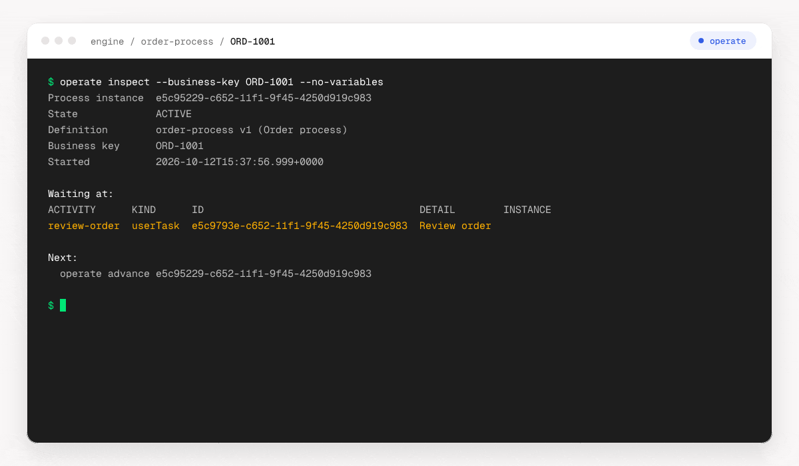

## One command per question

Six [workflow commands](./workflow-commands.md) combine several REST requests into one answer.
`operate status` triages the whole engine, `operate inspect` shows where one instance waits and
why, and `operate advance` completes what it waits for. They find the instance by id, business
key or as the latest of a definition, and every view lists the commands to run next.

## Every REST operation is a command

operate turns all 396 operations of the Camunda 7 REST API into commands such as
`operate task list`, and `operate api` sends a raw request. The
[command structure](./commands.md) explains names, variables and request bodies, the
[recipes](./recipes.md) have command lines for everyday tasks, and
[output and errors](./output-and-errors.md) lists the formats and exit codes.

## Your team decides what an agent may change

`operate guide` prints the usage guide an agent reads first, and the
[Claude Code plugin](./agents.md#claude-code-plugin) ships it as a skill. A profile created with
`--read-only` refuses every write, `--dry-run` previews a request and delete and bulk commands
need `--yes`, see [safety](./safety.md). Profiles and logins are in
[configuration](./configuration.md) and [authentication](./authentication.md).
